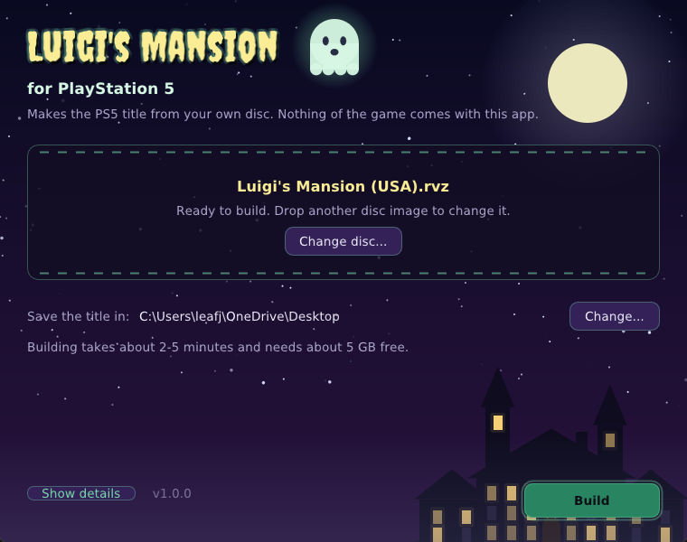
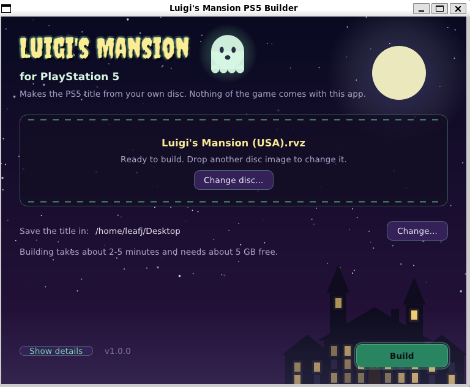

# Luigi's Mansion for the PlayStation 5

[](https://github.com/leafyjerk/PS5_LuigisMansion/stargazers)
[](https://github.com/leafyjerk/PS5_LuigisMansion/releases/latest)
[](LICENSE)

**Luigi's Mansion** (GameCube, 2001) as native PS5 homebrew, title `PPSA99351`, at 4K and
60 frames a second. Not an emulator: the game's own code, translated into C++ by
[Luigi's Mansion Recompiled](https://github.com/rob646464/luigis-mansion-recompiled) and compiled
for the console. Version 1.0.0.

You make the title yourself, from **your own disc**, with a small builder app for Windows or
Linux. Nothing of the game is in any download here.

> **USA disc only.** You need your own image of **Luigi's Mansion for the USA (`GLME01`)**. The
> European and Japanese releases are not supported yet. The builder checks your image before it
> starts.

## What you need

- A PS5 that runs homebrew (etaHEN or similar), with **ShadowMountPlus** and an **FTP server**
  (port 2121).
- A computer to build the title on, either:
  - a **Windows 10 or 11** PC (64-bit), or
  - a **Linux** PC (x86-64, with glibc 2.39 or newer: Ubuntu 24.04, Fedora 40, Debian 13 or later).

  About **5 GB free** on it while it builds.
- Your own image of the disc, in any GameCube format: `.iso`, `.gcm`, `.rvz`, `.wia`, `.gcz`,
  `.ciso`, `.nfs` or `.tgc`.
- An FTP program (FileZilla, for example).

## Set it up

### 1. Build the title

<p align="center">


</p>

1. From the [latest release](https://github.com/leafyjerk/PS5_LuigisMansion/releases/latest),
   download the builder for your computer and unzip it:
   - **Windows**: `LuigisMansion-PS5-Builder-1.0.0-windows.zip` gives you a folder **Luigi's
     Mansion PS5 Builder**. Open **Luigi's Mansion PS5 Builder.exe** in it. Keep the folder
     together: the app needs the `kit` folder and `lm-builder.exe` beside it. If SmartScreen says
     it doesn't know the app, choose **More info**, then **Run anyway**.
   - **Linux**: `LuigisMansion-PS5-Builder-1.0.0-linux.zip` gives you the same folder. Open
     **Luigi's Mansion PS5 Builder** in it (`./install-desktop-entry.sh` adds it to your app menu).
2. **Drop your disc image onto the window**, or click **Choose…** and pick it.
3. The title is saved on your **Desktop**. **Change…** picks another folder (on a drive with
   about 5 GB free).
4. Click **Build**. The window shows each step as it goes: checking your disc (another game or
   region stops it here, with the reason), making the disc image the console reads, reading and
   translating the game's code, compiling it for the PS5, and linking and putting the title
   together. It takes about a minute on a recent PC (an 8-core Ryzen: 42 seconds), longer on
   fewer cores. You can use the computer meanwhile; **Cancel** stops it.
   **Show details** has every tool's output, if something goes wrong.
5. When it says **Your title is ready**, **Open folder** shows you the result: a folder called
   **`PPSA99351`** (about 1.5 GB: it holds the disc image the game reads).

The builder downloads nothing and changes nothing else on your computer. Its temporary files
(about 3 GB, in a `PPSA99351-build` folder beside the title) are removed when it finishes or
stops.

> The title you build contains code translated from your disc, and your disc image. It is for
> your own console: please don't share it.

### 2. Copy it to the PS5

Copy the `PPSA99351` folder to the console over FTP, as `/data/homebrew/PPSA99351/`. Copy
`sce_sys/icon0.png` with it: ShadowMountPlus won't register a title without its icon.

### 3. Check the folder

When you're done it looks like this:

```
/data/homebrew/PPSA99351/
├── eboot.bin, pipelines.bin
├── GLME01.iso
├── sce_sys/, sce_module/, licenses/
└── userdata/          (made by the game: settings, saves, shader cache, log.txt)
```

### 4. Play

1. Start **Luigi's Mansion** from the home screen. The first start prepares the shaders for
   the console's GPU (a progress bar, a minute or two); later starts go straight to the game.
2. **Click the touch pad** for the settings menu.

The defaults are the best picture: 4K, 60 frames a second, widescreen.

### If something's wrong

- **It isn't on the home screen**: restart ShadowMountPlus (or the console).
- **The builder says the disc can't be used**: it says why. Most often it's another region's
  disc (only the USA `GLME01` works).
- **The builder stops**: see **Show details** for the reason. Check there are 5 GB free, then
  **Try again**.
- **The game closes back to the home screen**: copy `/data/homebrew/PPSA99351/userdata/log.txt`
  back and open an issue with it.

### Updating

Build the new version with the new builder and copy its `PPSA99351` folder over the old one.
Your saves and settings stay: they live in `/data/homebrew/PPSA99351/userdata/`, which the
builder never makes.

## What is better than on the GameCube

- **4K at 60 frames a second**: the game runs at its own 30 updates a second and every frame in
  between is interpolated, as Luigi's Mansion Recompiled does on the PC.
- **Widescreen** (Hor+), with the HUD at the screen's edges.
- **Luigi's Mansion Recompiled's options**, in a menu on the DualSense: rendering, enhanced
  lighting, gameplay tweaks and restored unused content.
- **Native**: the game's code runs as x86-64 on the console's own CPU.

## Controls

| Action | DualSense |
| --- | --- |
| Move (Control Stick) |  |
| Aim the Poltergust (C-Stick) |  |
| A |  |
| B |  |
| X |  |
| Y |  |
| Z |  (or ) |
| L, R (analog) | ,  |
| START |  |
| D-Pad | D-pad |
| **This port's settings** | **touch pad click** |

The game's own prompts still show the GameCube's buttons: **A** is
. In the settings menu the D-pad moves,
 chooses,
 goes back, and a touch pad click closes it
(changes are saved then).

## Known limits (1.0.0)

- Only the USA disc (`GLME01`).
- The game's prompts show the GameCube's buttons (above).
- The title carries the disc image (1.4 GB) beside it: the console's disc reader takes plain
  `.iso` images.
- Played on a PS5 through the start, the file select and into the game; not yet to the end.

## How it works

- **Luigi's Mansion Recompiled**
  ([rob646464/luigis-mansion-recompiled](https://github.com/rob646464/luigis-mansion-recompiled))
  translates the game's PowerPC code into C++ ahead of time (its own recompiler, with the
  [lm-decomp](https://github.com/SomeJakeGuy/lm-decomp) symbol map) and runs it on its own
  runtime, which stands in for the GameCube's system software and sound, with
  [Aurora](https://github.com/encounter/aurora) for the graphics, pads, memory cards and disc.
  This port builds its static build (`lmrecomp`) for the console, unchanged but for
  `ps5/patches/lm-recomp.patch` (every hunk behind `__PROSPERO__`): the console's folders, the
  disc beside the title, the exit, the settings menu on the DualSense, no updater.
- **Graphics**: Aurora draws through Dawn's WebGPU on Vulkan: RADV, Mesa's Vulkan driver, linked
  into the title ([PS5_Vulkan](https://github.com/mihawk-99/PS5_Vulkan)), output through
  `VK_KHR_display` at 3840x2160. Dawn's console patch, SDL3's video, sound and pad drivers and the
  disc reader are [PS5_Dusklight](https://github.com/griches/PS5_Dusklight)'s, the port of another
  Aurora game.
- **The builder** (`ps5/builder`): `nodtool` reads the player's disc and writes the plain image
  the console reads, Luigi's Mansion Recompiled's recompiler translates `main.dol`, LLVM 22's clang
  compiles the translation for the console with the build's own compiler job, and lld links it
  to the rest of the title, which comes in the builder's kit already built. The kit's link is
  recorded from this repository's own build, as the
  [Super Mario Galaxy port](https://github.com/griches/PS5_MarioGalaxy)'s builder does, so a
  title built from the same disc is byte-identical to the developer's, on Windows and on Linux.

## Build from source

On Linux (Ubuntu 24.04, or WSL2 on Windows), with [Mihawk's stack](https://github.com/mihawk-99/PS5_Vulkan)
beside this repository:

```text
somewhere/
  PS5_LuigisMansion/   this repository
  PS5_Vulkan/          https://github.com/mihawk-99/PS5_Vulkan   (with its RADV release archive built)
  PS5_PayloadSDK/      https://github.com/mihawk-99/PS5_PayloadSDK
```

```sh
git clone --recursive https://github.com/leafyjerk/PS5_LuigisMansion
cd PS5_LuigisMansion
ps5/tools/setup-stack.sh                       # host packages, LLVM 22, Mihawk's repos beside this one
ps5/tools/prepare-game.sh /path/to/your/GLME01.rvz   # the disc image, main.dol, the translation
ps5/tools/build.sh                             # -> dist/PPSA99351/ (eboot.bin, sce_sys, the disc...)
echo PS5_HOST=192.168.1.x:2121 > .env
ps5/tools/deploy.sh                            # the title over FTP
ps5/tools/fetch-log.sh                         # its log back, a crash symbolised
```

`ps5/tools/ship.sh` saves your edits to `vendor/luigis-mansion-recompiled` into
`ps5/patches/lm-recomp.patch`, builds and deploys. `setup-stack.sh` explains where RADV and
`libc.prx` come from (PS5_Vulkan's own build, or `RADV_ARCHIVE=` / `LIBC_PRX=`).

The builders:

```sh
ps5/builder/fetch-llvm.sh                      # LLVM 22.1.8 for the kits (Linux and Windows)
ps5/builder/fetch-app-deps.sh                  # SDL3, Dear ImGui, the fonts, MinGW-w64
PS5_KIT_DIR=build/kit-record ps5/tools/build.sh   # a build that records its link for the kits
ps5/builder/build-tools.sh linux 1.0.0         # the app, lm-builder, lmrecompile, ps5-native-tool, nodtool
ps5/builder/build-tools.sh windows 1.0.0       # the same for Windows (MinGW-w64, from Linux)
ps5/builder/make-kit.sh linux build/builder-kit-linux
ps5/builder/make-kit.sh windows build/builder-kit-windows
ps5/builder/package.sh linux 1.0.0             # -> dist/builder/LuigisMansion-PS5-Builder-1.0.0-linux.zip
ps5/builder/package.sh windows 1.0.0           # -> ...-windows.zip
```

The home-screen art (`ps5/art/make-title-art.py`) and the builder's look are the port's own:
a cartoon ghost, a moonlit night and a mansion on a hill. Nothing in them is from the game.

## Credits

See [CREDITS.md](CREDITS.md). In short:

- **Luigi's Mansion Recompiled** by **rob646464**: the recompiler and runtime this port is built on.
- **lm-decomp** by **SomeJakeGuy** and contributors; **Dusklight** by **Twilit Realm**.
- **Aurora**, **nod** and the Dawn fork by **Luke Street (encounter)**.
- **PS5_MarioGalaxy** and **PS5_Dusklight** by **Gary Riches (griches)**: this repository's model,
  its builder's design, and the PS5 patches and drivers for Aurora's stack.
- **PS5_Vulkan**, **PS5_Mesa**, **PS5_PayloadSDK** and the **PS5 Vulkan Template** by **Mihawk**.
- The [PS5 Payload SDK](https://github.com/ps5-payload-dev/sdk) (John Törnblom), BlackBearReloaded,
  Mesa's RADV, Dawn, SDL, Dear ImGui, LLVM, zlib.
- Fonts: Creepster (Sideshow, OFL), DejaVu. Button pictures: Kenney's Input Prompts (CC0).

## Licence

GPL-3.0, as the PS5 SDK's platform layer and the Super Mario Galaxy port's builder this follows.
The port's own files are MIT unless they say otherwise (each names its licence); PS5_Dusklight's
are MIT or Zlib. The title and the builder carry every component's licence text in `licenses/`.

Luigi's Mansion Recompiled is a submodule here, not a copy; its repository states no licence,
so its code is its author's, used here with credit.

Not affiliated with or endorsed by Nintendo. Luigi's Mansion is a trademark of Nintendo. No part
of the game is in this repository or its downloads: the title is made from your own disc.
